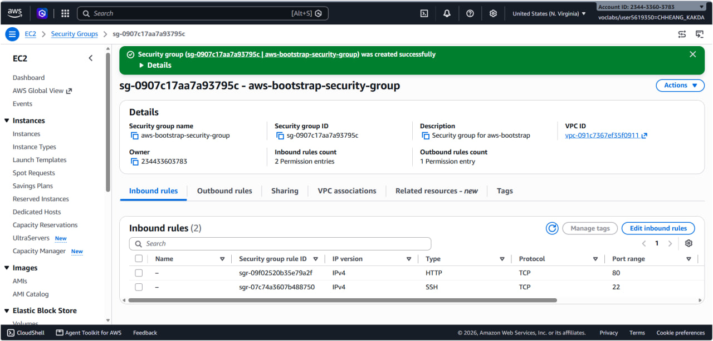
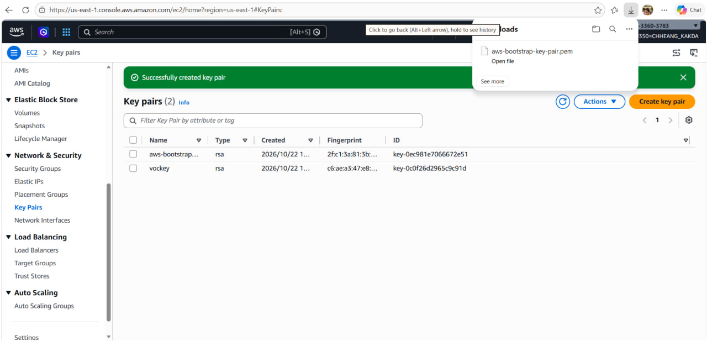
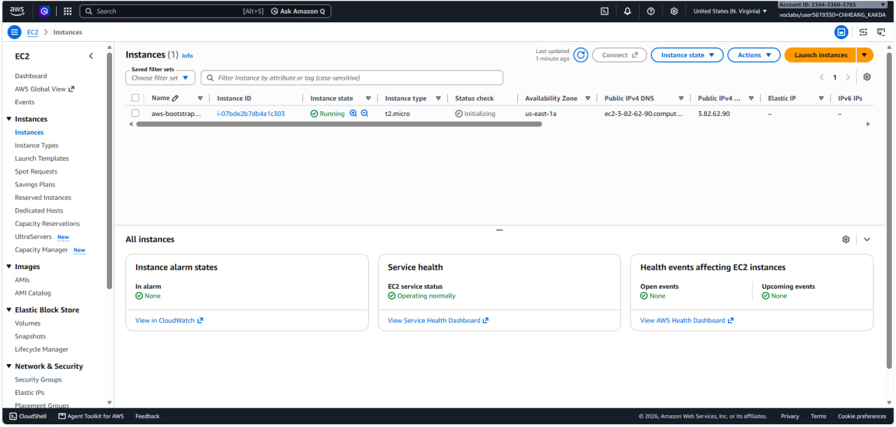
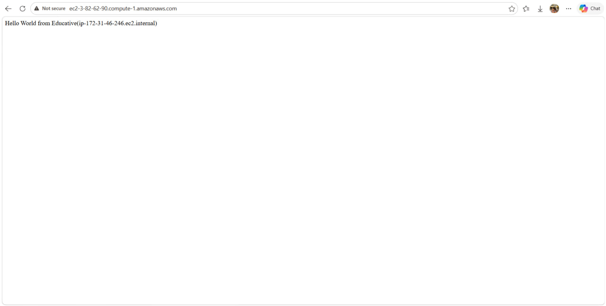
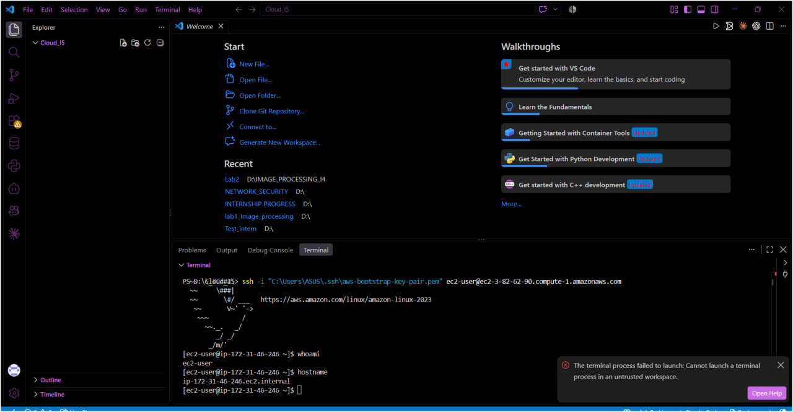
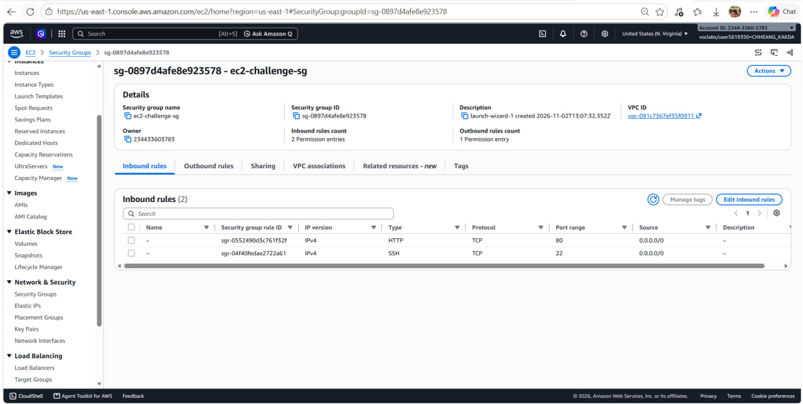
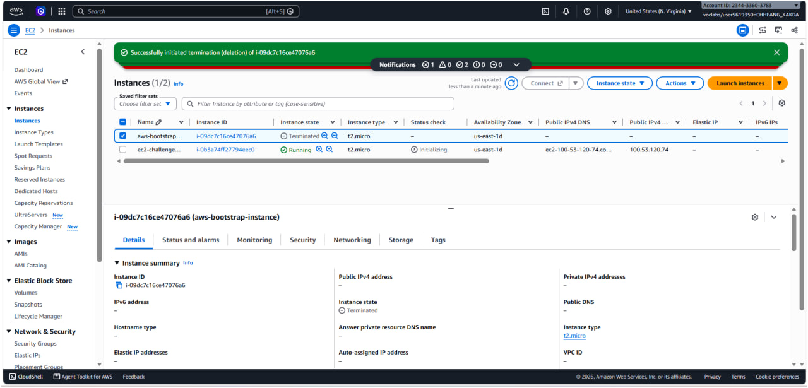
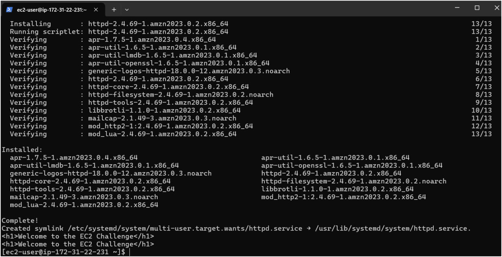
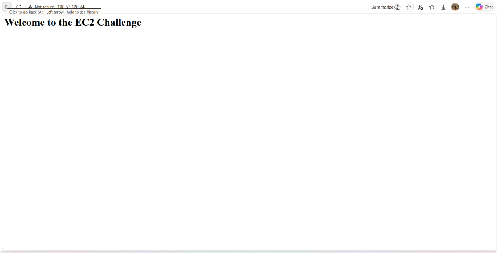

# Cloud Lab 1 Submission — Amazon EC2

- **Student name:** Chheang Kakda
- **Student ID:** e20221438
- **Learner Lab user name:** voclabs/user5619350=CHHEANG_KAKDA
- **Date completed:** 2026-11-02

---

## Part 1.1 — An Amazon EC2 Walkthrough

### Security group



### Key pair



### Instance details



### Browser test



### SSH connection



**Did you connect with your own SSH client or with EC2 Instance Connect?**

I connected with my own SSH client (OpenSSH in the VS Code terminal on Windows), using the downloaded key pair:

```bash
ssh -i "C:\Users\ASUS\.ssh\aws-bootstrap-key-pair.pem" ec2-user@ec2-3-82-62-90.compute-1.amazonaws.com
```

Then I ran `whoami` (`ec2-user`) and `hostname` (`ip-172-31-46-246.ec2.internal`) to confirm I was on the instance.

---

## Part 1.2 — EC2 Web Solution (Challenge)

### Launch configuration


### Security group



### Running instance



### Commands on the instance



**Paste the commands you ran to install the web server and create index.html:**

```bash
sudo dnf install -y httpd
sudo systemctl enable --now httpd
echo "<h1>Welcome to the EC2 Challenge</h1>" | sudo tee /var/www/html/index.html
cat /var/www/html/index.html
```

### Browser test



---

## Questions

**1. Your security group has an SSH rule and an HTTP rule. What does each one let you do? What would stop working if you deleted the HTTP rule?**

- The **SSH rule** (TCP port 22) allows inbound connections so I can log in to the instance remotely with an SSH client and my private key.
- The **HTTP rule** (TCP port 80) allows inbound web traffic so a browser can reach the Apache web server.
- If I deleted the HTTP rule, the web page would stop loading in the browser (the request would time out), because the security group blocks all inbound traffic that is not explicitly allowed. Apache would still be running, and SSH would still work.

**2. In Part 1.1 you never logged in to install the web server. What installed it, and when did it run?**

The **user data** script I put in *Advanced details → User data* when launching the instance installed it. User data is run by **cloud-init** as root **once, during the first boot** of the instance. It installed and started the web server and created the page that shows `Hello World from Educative(<hostname>)`.

**3. Why does the web page open with `http://` but not with `https://`?**

HTTPS uses TCP port **443** and needs a TLS certificate. The security group only allows port 80, and Apache was not configured with a certificate or a listener on 443. So `https://` connections are blocked or refused, while plain `http://` on port 80 works.

**4. Part 1.2 asked for a 10 GiB root volume. Where in the launch settings did you set it, and how can you check the size on the running instance?**

I set it in the **Configure storage** section of the *Launch an instance* page, changing the root volume (gp3) size from 8 to **10 GiB**. On the running instance I can check it with:

```bash
lsblk        # shows the disk xvda / nvme0n1 as 10G
df -h /      # shows the size of the root file system
```

It is also visible in the console under *Instance → Storage* tab.

---

## Problems and how I solved them (optional)

- **VS Code terminal would not start** ("Cannot launch a terminal process in an untrusted workspace"). I solved it by marking the folder as trusted (*Manage Workspace Trust → Trust*).
- **SSH key permissions:** the `.pem` file was downloaded to `Downloads`. I moved it to `C:\Users\ASUS\.ssh\` so SSH would accept it and it would not sit in a shared folder.

## AI note (optional)

An AI tool suggested `sudo systemctl enable --now httpd` instead of running `start` and `enable` separately. I checked it by reading the output (`Created symlink ... httpd.service`) and by opening the public IP in the browser, which showed the page.

---

## Clean up

- [x] Part 1.1: instance terminated, key pair and security group deleted.
- [ ] Part 1.2: instance terminated, security group (and key pair, if any) deleted.
