# Cloud Lab 2 Submission — Load Balancer and Auto Scaling

- **Student name:** Chheang Kakda
- **Student ID:** e20221438
- **Learner Lab user name:** voclabs/user5619350=CHHEANG_KAKDA
- **Date completed:** 2026-11-05

---

## Security groups

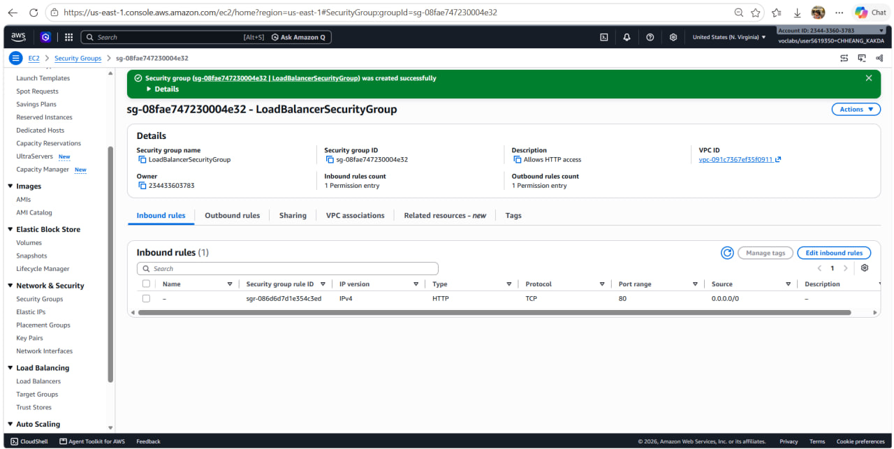

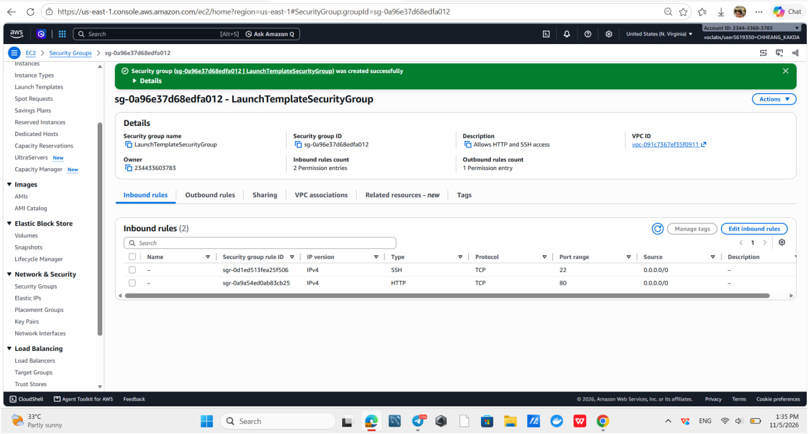

## Target group

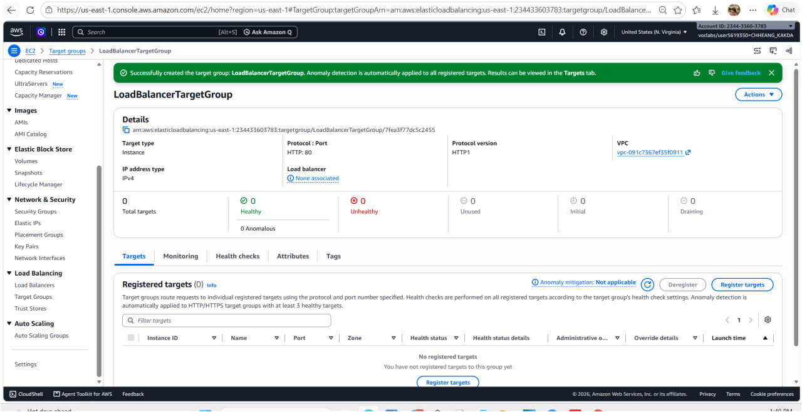

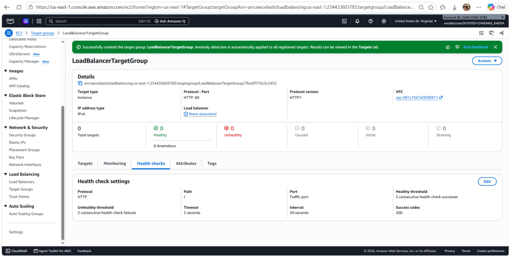

## Application Load Balancer

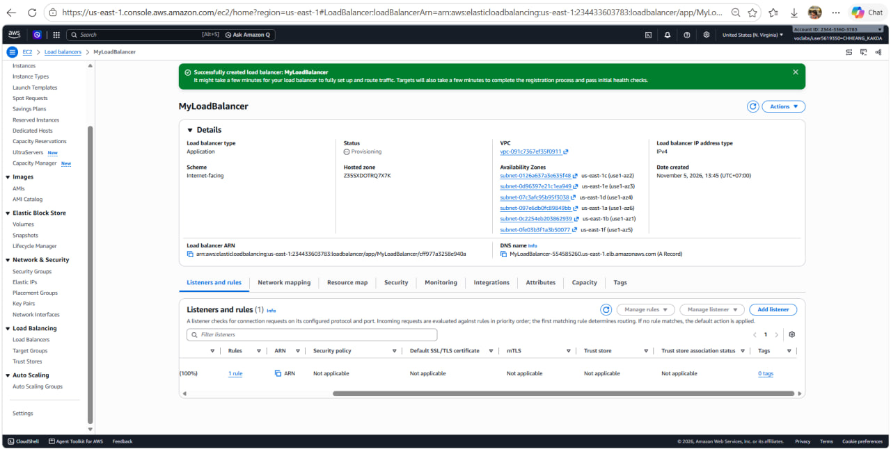

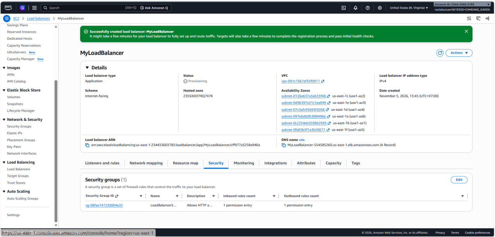

## Launch template

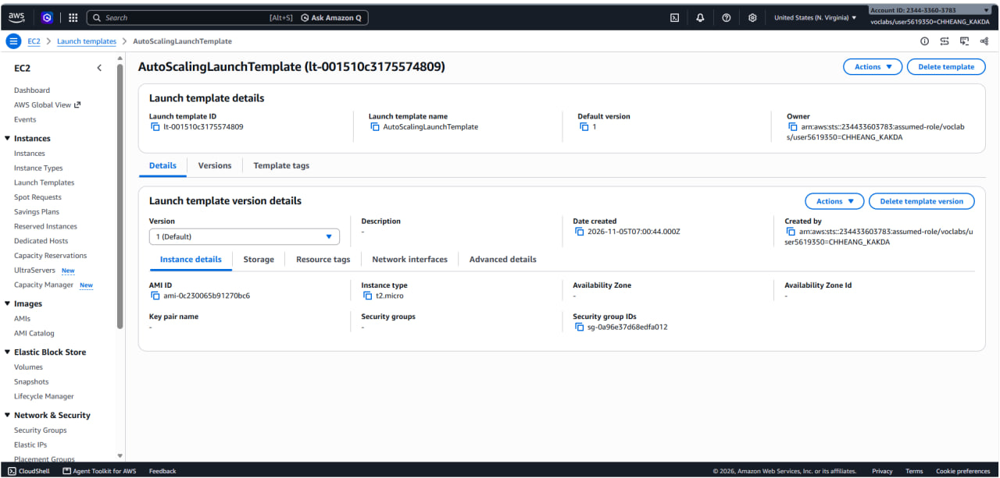

## Auto Scaling group

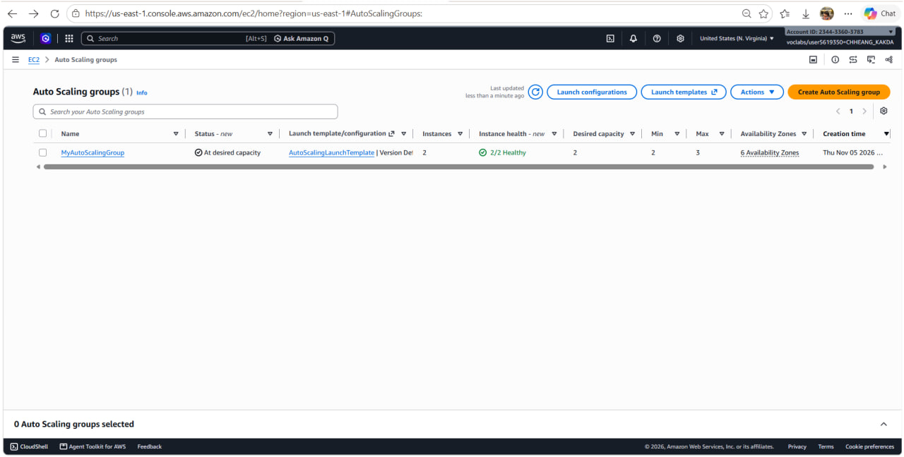

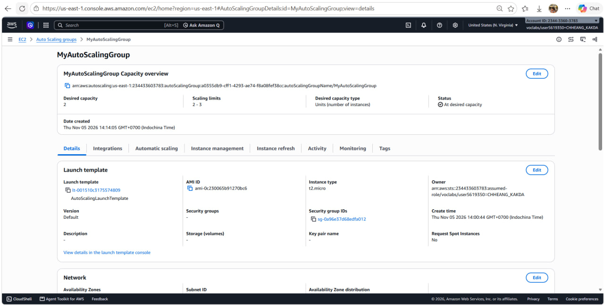

## Load balancing test

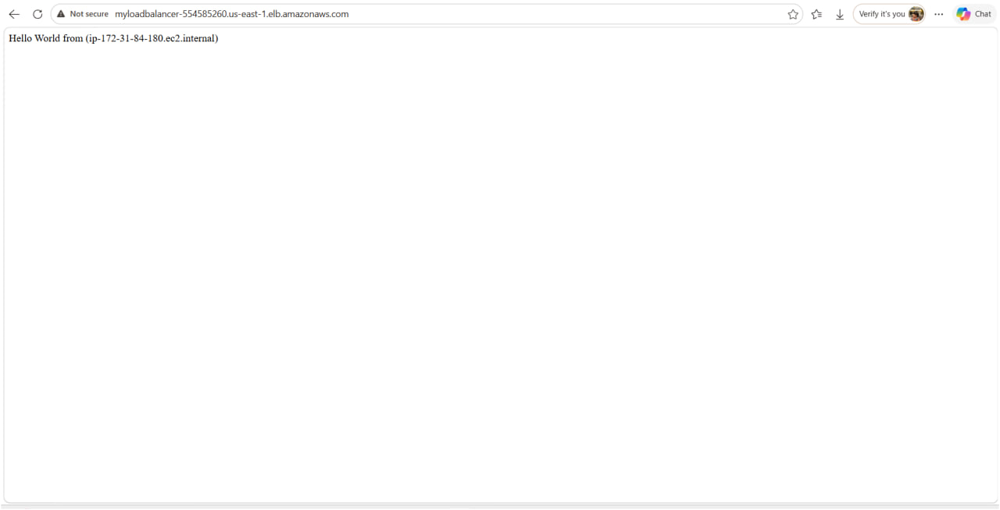

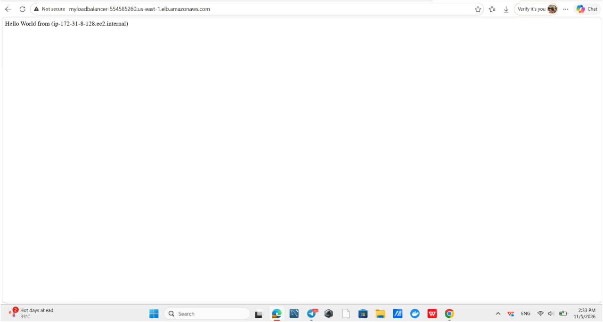

## Simulated application failure

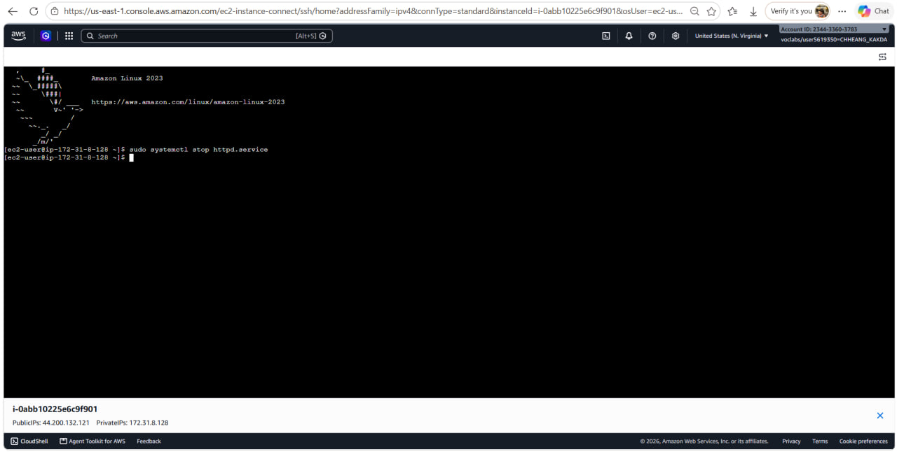

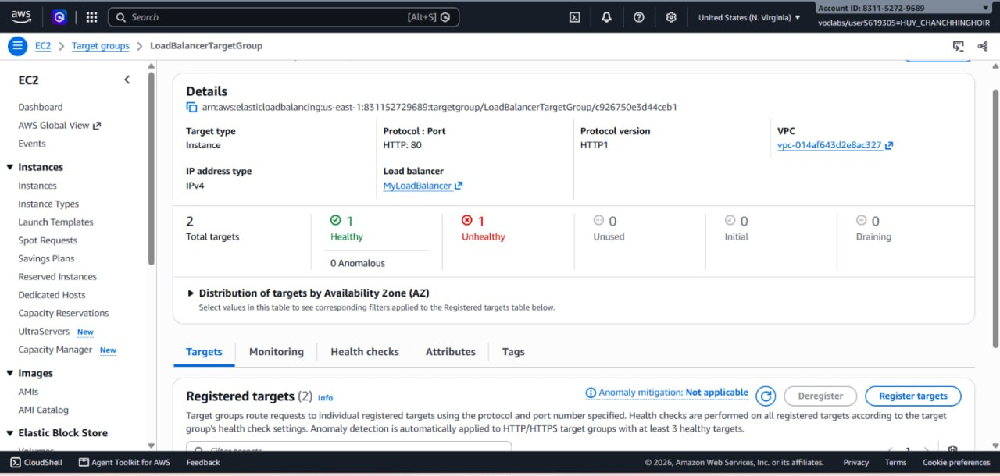

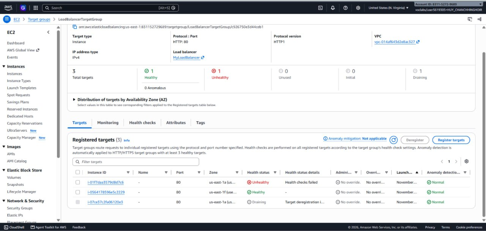

**About how many minutes passed between stopping `httpd` and the new instance becoming healthy?**

About 5 minutes. The target became unhealthy after about 1 minute (2 failed checks × 30 s interval). The Auto Scaling group then launched a new instance. It needed time to boot and run its user data, and then 5 successful checks × 30 s (about 2.5 min) to become healthy.

---

## Questions

**1. Why does the page show a different host name when you refresh it?**

The Application Load Balancer spreads requests across all healthy targets in the target group (round robin by default). Each instance's user data writes its own host name into the page. When I refresh, the request can go to the other instance, so the page shows a different host name (`ip-172-31-84-180` and then `ip-172-31-8-128`).

**2. After you stopped `httpd`, the instance was still *running* in EC2, but the target group marked it *unhealthy*. What did the health check test, and why did the instance fail it?**

The health check sends an HTTP `GET /` to each target on the traffic port (80) every 30 seconds and expects a `200` response within 5 seconds. EC2 status checks only test that the virtual machine and its hardware are working, so the instance still showed *running*. With `httpd` stopped, nothing was listening on port 80. The requests failed, and after 2 failures in a row (the unhealthy threshold) the target was marked unhealthy.

**3. Who replaced the failed instance: the load balancer, the target group, or the Auto Scaling group? Explain the role of each one.**

The **Auto Scaling group** replaced it.

- **Load balancer:** receives client requests on its listener (HTTP :80) and forwards them to the target group. It never launches or terminates instances.
- **Target group:** holds the list of registered targets, runs the health checks, and tells the load balancer which targets are healthy. It only *reports* health and stops traffic to unhealthy targets.
- **Auto Scaling group:** keeps the number of instances at the desired capacity. Because ELB health checks are turned on for the group, it saw the unhealthy result from the target group. It then terminated that instance (which was drained and deregistered) and launched a new one from the launch template. That new instance registered automatically in the target group.

**4. With desired 2, minimum 2 and maximum 3, how many instances run normally? In what situation could there be 3?**

Normally **2** instances run (the desired capacity). There could be **3** if a scaling policy scales out under load, for example when a target-tracking policy sees average CPU above its target. It could also happen if someone manually raises desired capacity to 3, or for a short time during a replacement or instance refresh. The group can never go above the maximum of 3.

**5. The instances' security group allows HTTP from anywhere. How could you change it so that the instances accept HTTP only from the load balancer?**

Edit the inbound rules of `LaunchTemplateSecurityGroup`. Change the HTTP (TCP 80) rule source from `0.0.0.0/0` to the load balancer's security group, `LoadBalancerSecurityGroup` (`sg-08fae747230004e32`). Then only traffic coming from the load balancer's network interfaces is allowed, and direct requests to the instances' public IPs are blocked. (For more safety, SSH could also be limited to my own IP, or removed and EC2 Instance Connect used instead.)

---

## Problems and how I solved them (optional)

- Right after I created the load balancer, its status was **Provisioning** and the DNS name did not work yet. I waited a few minutes until it became **Active** and the targets passed their health checks, and then the page loaded.
- I forgot to take screenshots 13 and 14 during the failure test, so I used a classmate's screenshots for those steps (see the note above).

## AI note (optional)

An AI tool suggested that the HTTP rule on the instances' security group should use the load balancer's security group as its source instead of `0.0.0.0/0` (Question 5). I checked the AWS documentation for security group rules, which says a source can be another security group ID.

## Clean up

- [ ] `MyAutoScalingGroup` deleted and its instances terminated.
- [ ] `AutoScalingLaunchTemplate` deleted.
- [ ] `MyLoadBalancer` and `LoadBalancerTargetGroup` deleted.
- [ ] Both security groups deleted.
