# Cloud Lab 4 Submission — Amazon VPC

- **Student name:** Chheang Kakda
- **Student ID:** e20221438
- **Learner Lab user name:** voclabs/user5619350=CHHEANG_KAKDA
- **Date completed:** 2026-11-19

---

## VPC and internet gateway

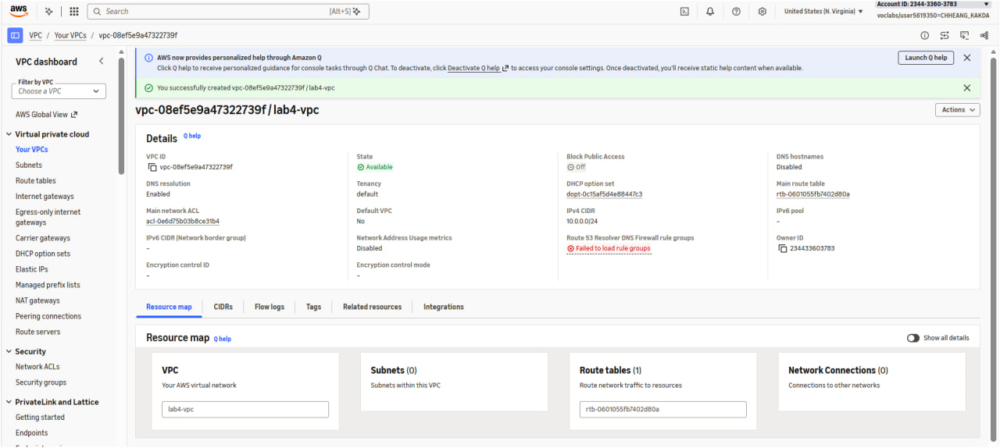

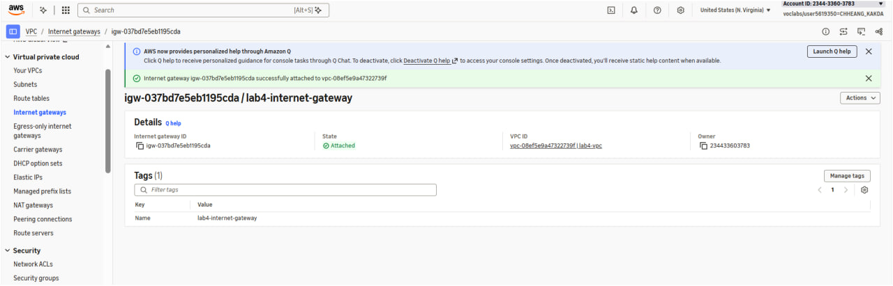

## Public subnet

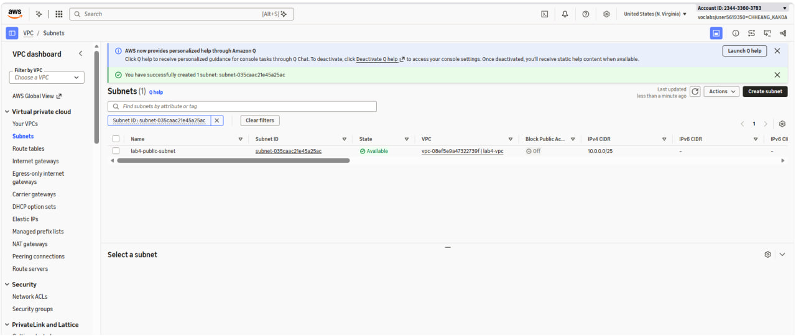

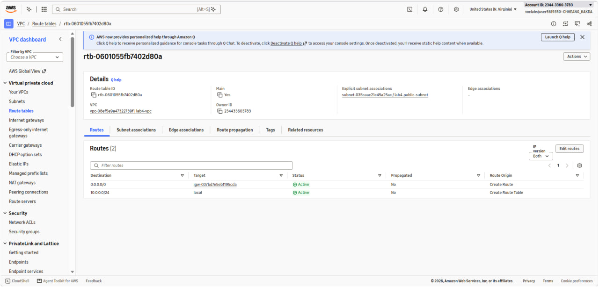

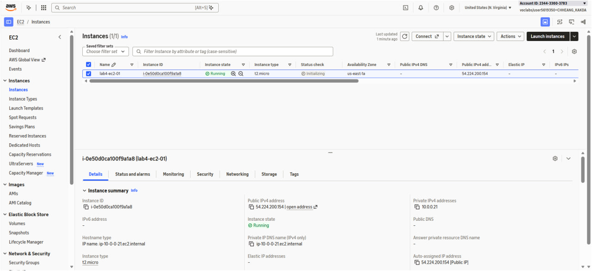

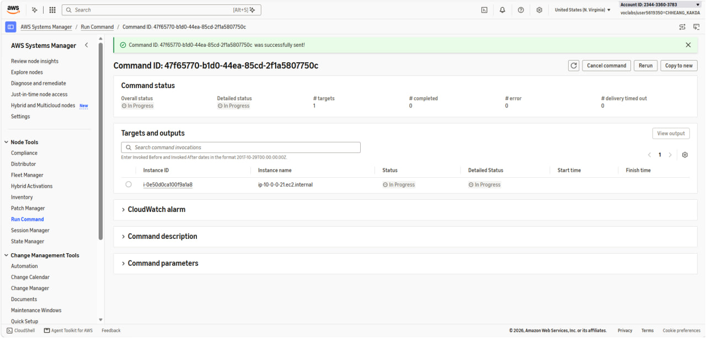

## Private subnet

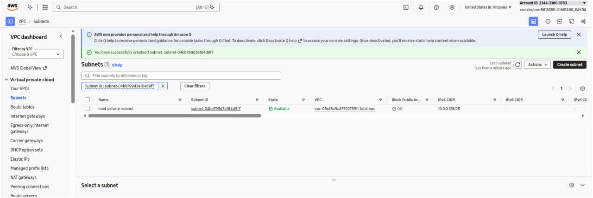

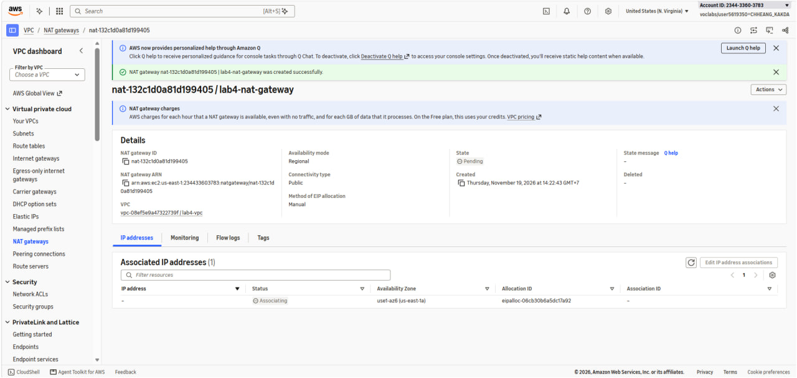

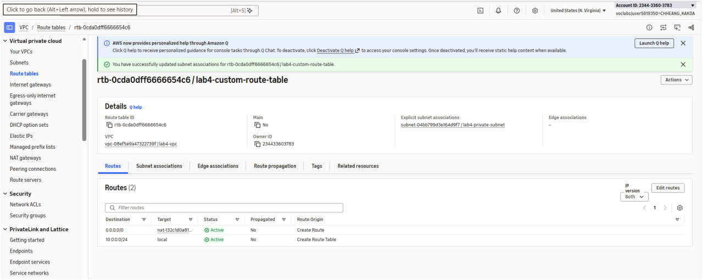

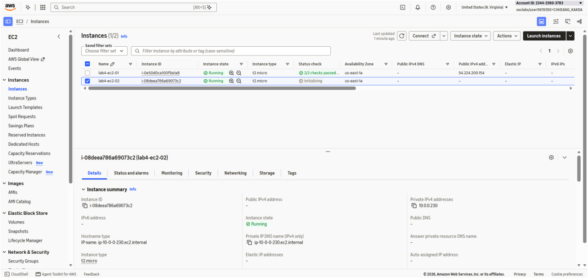

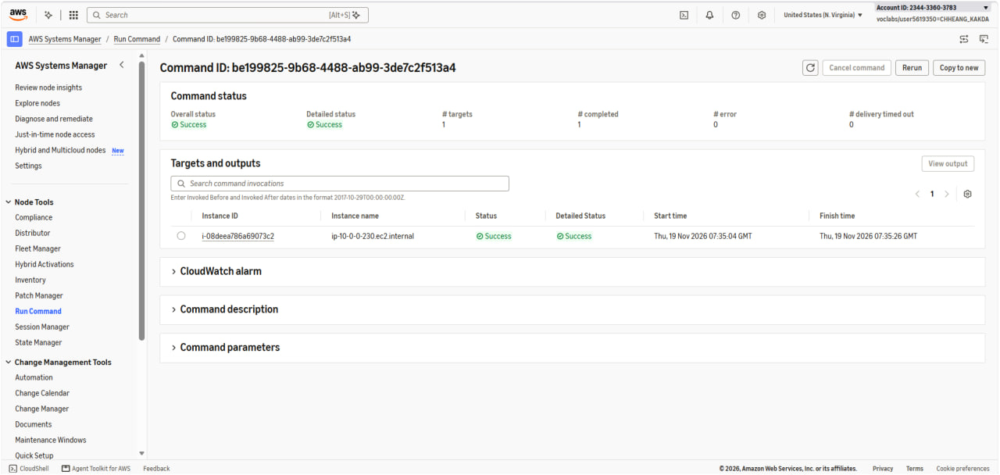

---

## Questions

**1. The VPC is `10.0.0.0/24` and the subnets are `10.0.0.0/25` and `10.0.0.128/25`. How many IP addresses does each block contain, and why do the two subnets not overlap?**

- `10.0.0.0/24` has 2^(32−24) = **256** addresses (`10.0.0.0` – `10.0.0.255`).
- Each `/25` has 2^(32−25) = **128** addresses. AWS reserves 5 in every subnet (network address, VPC router, DNS, one for future use, and broadcast), so **123** are usable in each.
- `10.0.0.0/25` covers `10.0.0.0` – `10.0.0.127` and `10.0.0.128/25` covers `10.0.0.128` – `10.0.0.255`. The extra prefix bit splits the `/24` into two equal halves, so the ranges are next to each other and do not overlap. Together they use the whole VPC range. This matches my instances: `lab4-ec2-01` got `10.0.0.21` (public half) and `lab4-ec2-02` got `10.0.0.230` (private half).

**2. Both subnets are in the same VPC. What exactly makes `lab4-public-subnet` public and `lab4-private-subnet` private?**

Only the **route table** attached to each subnet decides it.

- `lab4-public-subnet` uses route table `rtb-0601055fb7402d80a`, which has `0.0.0.0/0 → igw-037bd7e5eb1195cda` (the internet gateway). Instances with a public IP can send and receive traffic directly to and from the internet.
- `lab4-private-subnet` uses `lab4-custom-route-table` (`rtb-0cda0dff6666654c6`), which has `0.0.0.0/0 → nat-132c1d0a81d199405`. It has **no route to the internet gateway**, so nothing from the internet can reach it directly. Its outbound traffic goes through the NAT gateway.

**3. Why is the NAT gateway placed in the public subnet and not in the private one?**

The NAT gateway must itself reach the internet. It has an Elastic IP and sends traffic out through the internet gateway, which only works from a subnet whose route table points `0.0.0.0/0` to the IGW, which means the public subnet. If it were in the private subnet, its traffic would follow the private route table back to the NAT gateway itself and never reach the internet.

**4. `lab4-ec2-02` has no public IP address. Can someone on the internet open a connection to it? Can it download updates? Explain both answers.**

- **Inbound: No.** It only has a private address (`10.0.0.230`), which cannot be routed on the internet. There is no IGW route in its subnet, and a NAT gateway only allows return traffic for connections that started from inside. It does not accept new connections from outside.
- **Outbound: Yes.** It can download updates. Its requests go to the NAT gateway (`0.0.0.0/0 → nat-…`), which replaces the private source address with its Elastic IP and sends them out through the internet gateway. Replies come back the same way.

**5. You tested internet access with Systems Manager instead of SSH. Why did the instances need `LabInstanceProfile` for this?**

Run Command works through the SSM Agent on the instance. The agent must call the Systems Manager API to register the instance and fetch commands. AWS API calls need credentials, and `LabInstanceProfile` gives the instance an IAM role with Systems Manager permissions (such as `AmazonSSMManagedInstanceCore`). Without it, the instance never shows up as a managed node and the command cannot be sent. This also let me test the private instance without a public IP, SSH key, or bastion host. Its agent reached the Systems Manager endpoints through the NAT gateway.

---

## Problems and how I solved them (optional)

## AI note (optional)

## Clean up

- [ ] Instances terminated.
- [ ] NAT gateway deleted and its Elastic IP released.
- [ ] Internet gateway detached and deleted.
- [ ] `lab4-vpc` deleted.
